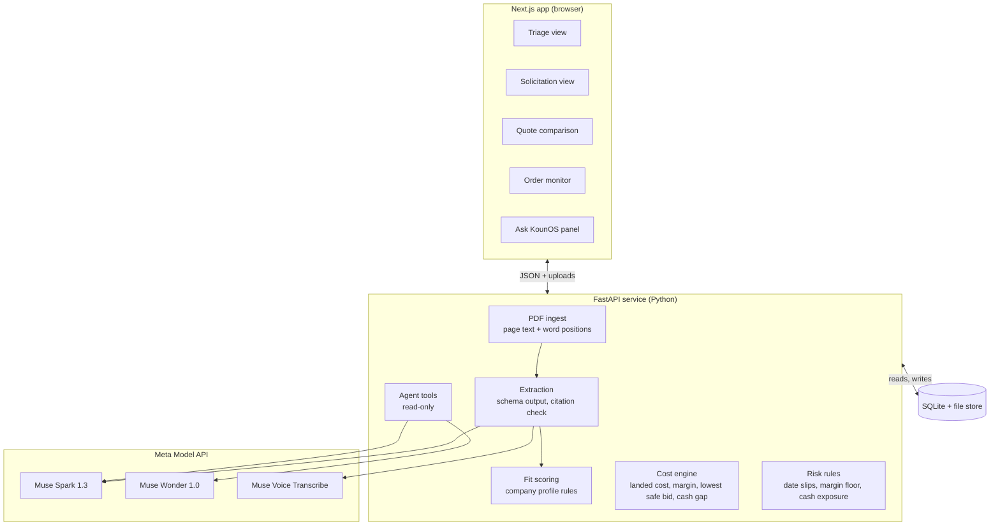

# KounOS

**An AI operating system for small government suppliers.** KounOS helps a supplier decide which contracts are worth pursuing, then keeps every awarded order on track until it's delivered and paid. It triages solicitations, reads the one worth chasing, compares supplier quotes, recommends whether to bid and at what price, and watches the order after award, so a supplier delay gets caught before it becomes a missed delivery.

Built by Koun Logistics LLC for **[HACKATHON NAME]** on Meta's Muse models through the Meta Model API.

**[▶ Demo video](TODO)** · **[Live demo](TODO)** · **[What we built this week](#built-during-the-hackathon)**

> **Hackathon prototype.** Everything in this repository was built between October 26 and November 4, 2026. The solicitation and award record are public federal documents. Suppliers, quotes, orders and the voicemail are fictional unless marked otherwise, and the awarded order is simulated. KounOS never submits bids or sends messages; people do.

<!-- TODO before submission: replace every [BRACKETED] placeholder and every TODO link, and trim any feature below that didn't ship. -->

---

## For judges

| Criterion | Where to look |
| --- | --- |
| **Impact** | [The problem](#the-problem) · [Who benefits](#who-benefits) · [Where it's going](#where-its-going) · [Checked against a real award](#checked-against-a-real-award) |
| **Use of Meta AI tooling** | [How we use Meta AI](#how-we-use-meta-ai) |
| **Technical depth and execution** | [Architecture](#architecture) · [Engineering decisions](#engineering-decisions) · [Validation](#validation) |
| **Demo** | [Demo](#demo) · [Run it locally](#run-it-locally) |
| **Rules** | [Built during the hackathon](#built-during-the-hackathon) · [Third-party software and data](#third-party-software-and-data) |

---

## The problem

Small businesses that supply the federal government do two hard jobs with scattered information.

**Deciding what to pursue.** New notices arrive constantly, and most are a poor fit: the wrong set-aside, products the company doesn't sell, a delivery window no supplier can meet. Each one worth a look can mean dozens of pages of line items, clauses and delivery terms, plus supplier quotes that arrive as PDFs, email text and photos of printed sheets. Pricing a bid that is both competitive and profitable takes hours.

**Delivering what they win.** After award, the order lives across purchase orders, tracking emails, invoices and a spreadsheet. A miss is expensive: a late delivery can lead to termination of the contract and a poor past-performance rating that follows the company into every future bid.

Small teams make up for both with manual checking, which caps how many opportunities and orders they can take on. Koun Logistics LLC is one of those businesses. KounOS is the system we're building to run it.

**Problem statement:** [NAME THE HACKATHON PROBLEM STATEMENT THIS ADDRESSES]

### Who benefits

- **Koun's team first.** Less time reading and re-keying documents, fewer bids on contracts that were never a fit, fewer surprises after award, more opportunities handled by the same people.
- **Other small procurement and supply businesses**, as the product matures.
- **Government buyers, indirectly.** Better-checked bids and fewer late deliveries.

### Where it's going

Koun is customer zero. KounOS is built as Koun's own operating software first, and designed so any small government supplier could run on it: everything specific to a company (its certifications, the products it sells, its margin floor) lives in a company profile, not in the code. Whether to offer KounOS as a B2B product will be decided from Koun's own results with it.

---

## What KounOS does

KounOS does two jobs. The prototype proves both end to end on real contracts that have already been awarded.

### Job 1: decide what's worth pursuing

1. **Triage the notices.** Load a batch of solicitations. KounOS pulls the facts that decide fit from each one (set-aside, product category, quantities, delivery window, estimated value), and code scores them against the company profile. Each notice gets "pursue" or "pass", with the reason for every factor.
2. **Read the solicitation.** Open one worth pursuing. KounOS extracts line items, part numbers, quantities, the delivery requirement and key clauses. Every field links to the page and passage it came from, and code checks each quoted passage against the document before marking it verified. Gaps and ambiguities are flagged for review.
3. **Compare supplier quotes.** Drop in quotes in any format: a PDF, a phone photo of a printed quote, an email screenshot. KounOS normalizes them and checks each against the requirements for delivery date, compliance and price.
4. **Recommend a bid.** Landed cost, margin at a given bid price, and the lowest safe bid at a target margin, all computed in code. KounOS recommends "pursue at $X" or "pass, because...", and the user picks a supplier and gets a one-page sourcing package.
5. **Check against reality.** Because the demo contract was already awarded, KounOS's recommendation sits next to what the government actually paid.

### Job 2: keep awarded orders on track

6. **Monitor the order.** On a simulated award, KounOS links the customer commitment to the supplier PO, shipment, invoice and payment dates. When the supplier leaves a voicemail about a delay, KounOS turns it into an event, traces it to the customer delivery date, prices each recovery option against margin and cash, and drafts a note for a person to review.
7. **Ask KounOS.** "Which orders need attention today?" Answers come from tool calls over the records, with a link to every record used.

**People stay in charge.** KounOS recommends. Koun's team reviews supplier selections, bids and every external action. It never submits a bid or sends a message.

---

## Demo

**[▶ Demo video](TODO)** (3 minutes) · **[Live demo](TODO)**

| Time | What you see |
| --- | --- |
| 0:00 | The problem: a supplier's work scattered across PDFs, email and spreadsheets |
| 0:15 | Triage: a batch of real notices sorted into pursue and pass, with a reason for each |
| 0:30 | A real [AGENCY] solicitation ([SOLICITATION NUMBER]), awarded in [MONTH YEAR], read with every field linked to its source |
| 0:55 | Three quotes in three formats. The cheapest misses the delivery date, the next fails a sourcing requirement, the third meets everything at a thinner margin |
| 1:25 | The recommendation, "pursue at $X", next to the actual award |
| 1:40 | The contract replayed as if Koun had won, clearly labeled as a simulation |
| 1:50 | The supplier's voicemail reports a 16-day slip. KounOS shows the delivery will now miss by 2 days and prices the fixes |
| 2:25 | "Which orders need attention today?" |
| 2:45 | What we built and what's next |

The live demo opens on the same scenario. **Reset demo** restores it at any time. When replay mode is on, the UI says so.

---

## How we use Meta AI

KounOS uses three Meta models through the [Meta Model API](https://dev.meta.ai/docs/overview), each for the job it fits best. Every AI result in the interface is labeled with the model that produced it.

| Step | Model | Capability | How |
| --- | --- | --- | --- |
| Triage notices | Muse Spark 1.3 (`muse-spark-1.3`) | Native PDF input, structured output | Pulls the fit facts (set-aside, product category, quantities, delivery window, estimated value) from each notice, with citations; code does the scoring |
| Read the solicitation | Muse Spark 1.3 | Native PDF input, structured output | The PDF goes in as-is. A JSON schema requires a page number and a verbatim snippet for every field |
| Flag gaps and ambiguity | Muse Spark 1.3 | Reasoning effort `high` | A second pass asks what a contracting specialist would question and links each flag to its clause |
| Read quotes in any format | Muse Spark 1.3 | PDF and image input, structured output | One schema covers a PDF, a phone photo and an email screenshot |
| Turn a voicemail into an event | Muse Voice Transcribe (`muse-voice-transcribe-1.0`), then Muse Spark 1.3 | Speech to text, structured output | Transcript → supplier, PO, affected items, new ship date, confidence |
| Explain impact and options | Muse Wonder (`muse-wonder-1.0`) | Parallel tool calling | Wonder calls read-only tools (order, commitments, alternate quotes, margin, cash gap) and writes its explanation from their results |
| Answer questions | Muse Spark 1.3 | Tool calling, prompt caching | Read-only tools over the database; answers cite record IDs |
| Draft a note | Muse Spark 1.3 | Text generation | A draft to the contracting officer or supplier that a person edits. Nothing is sent |

What's worth noticing:

- **Citations are checked, not trusted.** The model must quote its source; our code confirms the quote is really on that page before the field is marked verified.
- **One pipeline for messy inputs.** The same structured-output schema reads a PDF, a phone photo and a screenshot, which is how quotes actually arrive.
- **A second Meta model for a real channel.** Small suppliers often call instead of emailing. Muse Voice Transcribe turns that call into a structured order event.
- **An agent that can't make up numbers.** Muse Wonder reasons over tool results, and any figure in its explanation that no tool returned causes the response to be rejected.
- **The right model for each step.** Muse Spark handles high-volume reading; Muse Wonder handles the one hard judgment call; reasoning effort is set per step.
- **Careful data handling.** We use Standard-mode model IDs only. Meta does not use Standard-mode content to train its models.

---

## Architecture

**Models read and explain. Code computes. People decide.**



Only the extraction step and the agent tools touch a model. Every number and date comparison comes from code a reviewer can read.

### Tech stack

| Layer | Choice | Why |
| --- | --- | --- |
| Front end | Next.js, Tailwind CSS, shadcn/ui | Fast to build four polished screens |
| PDF viewer | react-pdf (PDF.js) with text-layer highlights | Click a requirement and jump to its passage |
| API | Python, FastAPI, Pydantic | Pydantic models double as the JSON schemas sent for structured output |
| PDF text and positions | pdfplumber | Page text with word coordinates; MIT-licensed |
| Snippet check | RapidFuzz | Tolerates line breaks and hyphenation when matching quotes to the page |
| Database | SQLite via SQLModel | Zero setup; seed and reset in one call |
| Model client | OpenAI Python SDK pointed at `https://api.meta.ai/v1` (Responses API) | One client for every Muse model |
| Hosting | [FRONT-END HOST] and [API HOST] | A live link judges can open |

### Data model

Company profile → Notice → Fit assessment (per-factor scores and reasons) → Solicitation → Award record (actual total, date, offers received) → Requirement (with source references) → Quote → Quote line → Sourcing decision → Order → Supplier PO → Shipment → Invoice → Event → Flag.

Each source reference stores the document, page, snippet, box coordinates and whether the snippet was verified.

---

## Engineering decisions

**1. Verified citations.** For every extracted field, the model returns a page number and a verbatim snippet. We extract that page's text with pdfplumber and fuzzy-match the snippet against it. A match marks the field verified and gives us word coordinates to highlight in the viewer. A miss marks it "needs review" instead of hiding the problem.

**2. Deterministic math.** Money and dates never come from a model.

| Quantity | Formula |
| --- | --- |
| Landed cost | supplier price + freight + fees |
| Margin | (bid − landed cost) ÷ bid |
| Lowest safe bid | landed cost ÷ (1 − target margin) |
| Delivery slack | required delivery date − projected arrival date |
| Cash exposure | amount paid to the supplier × days until government payment |

**3. Rules decide; models explain.** Pursue-or-pass is scored by plain rules against the company profile; the model only extracts the facts each rule needs, with citations. Likewise, delivery slips past the required date, margins below a floor and cash exposure are detected by plain rules, and Muse Wonder is called only to explain a flag and price options, using tool results.

**4. Grounded explanations.** Every number in a model explanation must match a value a tool returned. If it doesn't, the response is rejected and the plain rule-based flag is shown instead.

**5. Untrusted documents stay data.** Uploaded files can contain text aimed at the AI. Document text is passed as data, every tool the models can call is read-only, and nothing in the system can submit, send or write outside the app. Documents whose text addresses the AI are held for human review.

**6. Validated outputs.** Pydantic models define the JSON schemas. Model output is validated before anything is stored.

**7. Swappable models.** Model IDs live in configuration. Muse Wonder is in preview, so the impact step can fall back to Muse Spark 1.3, which takes the same requests on the same endpoints.

**8. A demo that holds up live.** Seed and reset endpoints restore the scenario. Replay mode serves stored responses for the scripted path if the network or API is slow, and the UI shows when it's active.

---

## Validation

### Extraction accuracy

Measured against hand-labeled expected fields for three awarded solicitations (`eval/`).

| Field | [SOLICITATION A] | [SOLICITATION B] | [SOLICITATION C] |
| --- | --- | --- | --- |
| Line items | TODO | TODO | TODO |
| Quantities | TODO | TODO | TODO |
| Delivery requirement | TODO | TODO | TODO |
| Key clauses | TODO | TODO | TODO |
| Citations verified | TODO | TODO | TODO |

Run it with `python -m eval.run` from the repo root, with the API's virtual environment active.

### Checked against a real award

| | Value |
| --- | --- |
| KounOS lowest safe bid (10% target margin) | [TODO] |
| Actual award total | [TODO] |
| Award date | [TODO] |
| Offers received | [TODO] |

How to read it:
- Only the award total is public, not line-item prices, so we compare totals.
- Our supplier prices reflect today's market, not prices at bid time. We chose an award from the last six months to limit drift.
- The winner had its own costs and strategy. This shows whether Koun would have been competitive, not an accuracy score.

---

## Run it locally

**Requirements:** Python 3.12+, Node.js 20+, and a Meta Model API key from [dev.meta.ai](https://dev.meta.ai/).

```bash
git clone https://github.com/[OWNER]/kounos.git
cd kounos
cp .env.example .env          # add your MODEL_API_KEY

# API
cd api
python -m venv .venv && source .venv/bin/activate
pip install -r requirements.txt
uvicorn app.main:app --reload --port 8000

# Web app (new terminal, from the repo root)
cd web
npm ci
npm run dev                   # http://localhost:3000
```

| Variable | Purpose | Default |
| --- | --- | --- |
| `MODEL_API_KEY` | Meta Model API key | required |
| `META_BASE_URL` | Meta Model API base URL | `https://api.meta.ai/v1` |
| `MODEL_READ` | Extraction, quotes, questions, drafts | `muse-spark-1.3` |
| `MODEL_IMPACT` | Impact analysis | `muse-wonder-1.0` |
| `MODEL_TRANSCRIBE` | Voicemail transcription | `muse-voice-transcribe-1.0` |
| `DEMO_MODE` | `live` calls the models; `replay` serves stored responses for the scripted path | `live` |
| `NEXT_PUBLIC_API_URL` | Where the web app finds the API | `http://localhost:8000` |

On Windows, activate the API venv with `.venv\Scripts\activate` (from `api/`) instead of `source .venv/bin/activate`.

### Repository layout

```
api/     FastAPI service: ingest, extraction, fit scoring, cost engine, rules, agent tools
web/     Next.js app: triage, solicitation, quotes, order monitor, Ask KounOS
data/    Demo scenario: company profile, public notices and award records, fictional quotes, voicemail
eval/    Hand-labeled expected fields and the eval script
```

---

## Built during the hackathon

All code in this repository was written between **October 26 and November 4, 2026**. No pre-existing Koun code was used. The first commit is an empty scaffold: [FIRST COMMIT LINK].

Built by Koun Logistics LLC with Muse Code (Meta) for implementation, planning and review; early planning briefs by Claude Code (Anthropic).

<!-- TODO: keep this list matched to what actually shipped. -->

- Running scaffold: API health route and a placeholder web shell with live API status

- Opportunity triage: pursue-or-pass on a batch of notices, scored against the company profile with a reason per factor
- Solicitation reader with page-linked, verified citations and gap flags
- Quote intake from PDFs, photos and screenshots, with requirement checks
- Cost engine: landed cost, margin, lowest safe bid, cash exposure
- Bid recommendation, one-page sourcing package and the award comparison
- Simulated order timeline linking commitment, PO, shipment, invoice and payment
- Voicemail-to-event pipeline with Muse Voice Transcribe
- Risk rules and Muse Wonder impact analysis with priced recovery options
- Number grounding: an explanation citing any figure no tool returned is discarded and replaced by code-written option text and the rule-based flags
- Draft notes for human review
- Ask KounOS assistant with record-linked answers
- Seed, reset and replay mode for the demo
- Extraction eval set and script

---

## Third-party software and data

### Libraries

| Library | License | Used for |
| --- | --- | --- |
| Next.js, React | MIT | Web app |
| Tailwind CSS | MIT | Styling |
| shadcn/ui | MIT | UI components |
| shadcn runtime (shadcn, @base-ui/react, cn, tw-animate-css, class-variance-authority) | MIT (class-variance-authority: Apache-2.0) | shadcn/ui primitives and utils |
| react-pdf (PDF.js) | MIT (PDF.js: Apache-2.0) | PDF viewer |
| FastAPI | MIT | API |
| Pydantic, SQLModel | MIT | Schemas and database |
| Uvicorn | BSD-3-Clause | API server |
| pdfplumber | MIT | PDF text and word positions |
| RapidFuzz | MIT | Snippet matching |
| OpenAI Python SDK | Apache-2.0 | Client for the Meta Model API |
| Geist font | SIL Open Font License 1.1 | Typeface |
| Lucide icons | ISC | Icons |
| Pydantic Settings | MIT | Env-based API settings |
| pytest, httpx | MIT (httpx: BSD-3-Clause) | API tests |
| ruff, mypy | MIT | API lint and typecheck |
| ESLint, TypeScript | MIT (TypeScript: Apache-2.0) | Web lint and types |

Meta's models are called as hosted services and are not bundled in this repository.

### Data and assets

- **Solicitations:** the demo solicitation, [AGENCY] [SOLICITATION NUMBER], and the triage batch are public federal documents from SAM.gov: [LIST EACH WITH ITS LINK]. Works of the U.S. federal government are generally not subject to copyright.
- **Award records:** public contract award data from [SAM.gov / USAspending.gov LINKS].
- **Company profile:** Koun's public eligibility facts (certifications and product codes, as registered in SAM.gov) plus a demonstration margin floor, not Koun's real one.
- **Suppliers, quotes, orders and voicemail:** fictional, created by the team. The voicemail was recorded by a team member. Supplier names were checked against real companies.
- **Real supplier quotes:** [NONE / list each one here, with the supplier's written permission on file].
- No real Koun customer, supplier or pricing data is in this repository.

---

## Scope and limitations

**Out of scope for the prototype:** live SAM.gov or DIBBS feeds, bid submission, sending email or messages, logins and multiple users, accounting integrations, and real customer or supplier data.

**Known limitations:**
- Triage runs on a saved batch of notices, not a live feed.
- Quote prices come from public list prices and fictional suppliers, not negotiated pricing.
- The award comparison covers one contract and compares totals only.
- Extraction has been evaluated on three solicitations.
- Order monitoring runs on a simulated award.

---

## What's next

- Run KounOS on Koun's live opportunities and real orders, in a private production codebase
- Live solicitation feeds into triage, and award history for pricing context
- Supplier messaging, with approval before anything is sent
- Risk monitoring across all open orders, including government shutdown scenarios (current federal funding runs through December 11, 2026)
- Backtesting across many past awards to calibrate bids
- Deciding, from Koun's own results, whether to offer KounOS to other small procurement and supply businesses

---

## Team

| Name | Role |
| --- | --- |
| [NAME] | [ROLE] |

Koun Logistics LLC

## License

[LICENSE NAME]. See [LICENSE](LICENSE).
