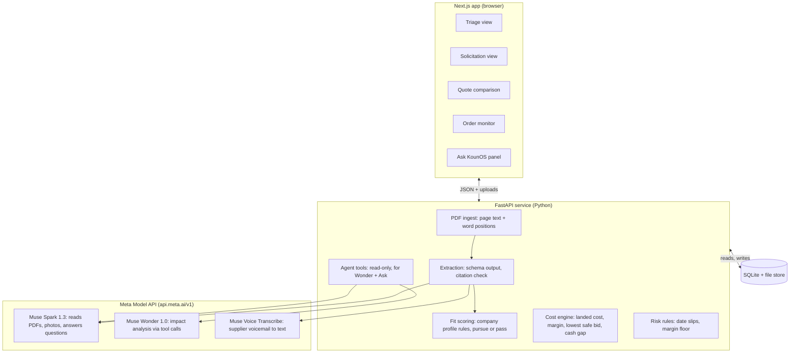

# KounOS Hackathon Build Plan

The baseline for the KounOS hackathon prototype. Agents: treat this as the source of truth for scope and design; `TASKS.md` turns it into work items and `docs/RUBRIC.md` defines how work is judged.

Deadline: **Wed, Nov 4, 2026, 9 PM ET** (7 PM Phoenix). Late submissions are not considered.

## The one story

KounOS does two jobs for a small government supplier: **decide which contracts are worth pursuing**, and **keep every awarded order on track** until it's delivered and paid. The prototype proves both in one loop on real, already-awarded contracts: triage a batch of notices, read the one worth pursuing, pick the right supplier, recommend a bid and check it against the actual award, then catch a delay before it becomes a missed delivery. Anything that does not serve that loop is cut.

The demo in one breath: KounOS sorts a batch of real civilian-agency notices into pursue and pass, with a reason for each. We open the best fit, a recently awarded solicitation for electrical supplies. KounOS extracts line items, quantities, the delivery requirement and key clauses, each linked to the exact page and passage it came from. We drop in three supplier quotes. The cheapest misses the delivery date, the second fails a sourcing requirement, and the third meets everything at a thinner margin. The user picks it, gets a sourcing package, and KounOS's recommendation, "pursue at $X", appears next to the price the government actually paid.

Then we replay the contract as if Koun had won, under a clearly labeled simulated award. The supplier emails a backorder notice (ship moves to Dec 31, arrival Jan 3). KounOS ties it to the customer commitment, shows the delivery will now miss by 2 days, prices each recovery option against margin and cash, and drafts a note for a human to review. KounOS never bids or sends anything; Koun's people make every external move.

Target: a 3-minute video in which every frame shows something built during the hackathon.

## Scoring strategy

Impact and Meta tooling carry 55% of the score, so build time goes first to visible AI steps and a believable small-business problem. Technical depth is won by keeping math out of the model; the demo is won by one continuous story.

| Criterion | Weight | What wins it for KounOS | Where judges see it |
| --- | --- | --- | --- |
| Impact | 30% | A real company with two real pains: chasing contracts that were never a fit, and late deliveries that can trigger termination and a poor past-performance rating. The demo is checked against a real award. Koun is customer zero for a product any small supplier could use. Name the problem statement it fits. | Opening 20 seconds of the video; README "Who benefits" and "Where it's going" |
| Use of Meta AI tooling | 25% | Three Meta models doing five distinct jobs: triage of notices, native PDF reading with checked citations, multimodal quote intake, voicemail transcription, and a tool-calling agent for impact analysis | Each AI result is labeled with the Muse model that produced it |
| Technical depth | 20% | Models read and explain, code computes, people decide: deterministic cost, date and cash math; schema-validated outputs; citation checks; a small eval set | Verified-citation badges; README architecture and eval table |
| Demo | 25% | One continuous story from triage to rescue, with two memorable moments (the award reveal and the voicemail), seeded data, a reset button and a replay fallback | 3-minute video plus a live link |

Rough split of build time: AI pipeline 40%, the four screens 25%, demo data 15%, video and submission 20%.

## Product direction

**Decided: KounOS is Koun's own operating software first, designed so any small government supplier could use it. Whether to sell it as a B2B product is decided later, from Koun's own results.**

- **Why not commit to SaaS now:** a product for other suppliers needs accounts, logins, billing, support and strict separation of each customer's data, and those customers would be the suppliers Koun bids against, trusting KounOS with their pricing. None of that helps win this hackathon or Koun's next bid.
- **Why keep the door open:** Impact asks whether this could become something people use. Finding contracts is a crowded market (SamSearch, HigherGov, Govly and others); keeping awarded orders on track for small resellers is less served, and that's KounOS's strongest angle.
- **What that means for the build:** everything specific to a company (set-aside certifications, product categories, margin floor) lives in one company profile file, never in code. No multi-company accounts or logins in the prototype.
- **For the pitch:** "Koun is customer zero."
- **Revisit** after Koun has used KounOS on real bids and orders for a few months: is it saving real hours, and would other small suppliers pay for it? That answer also settles the license question (below).

## Rules compliance

Four things can disqualify the project: private code, unclear new work, missing rights to a document or asset, and the event's ban on politics and war topics.

- A public repo whose first commit is an empty scaffold, so the history shows everything was built during the event. Commit small and often.
- A license chosen on day one. A permissive license (MIT, Apache-2.0) lets anyone reuse the code commercially; AGPL-3.0 requires anyone who runs a modified version as a service to publish their changes.
- This repo is a public prototype. Koun's real supplier pricing, customer names and margin rules stay out of it; production KounOS will live in a separate private repo later. The demo company profile uses Koun's public eligibility facts (as registered in SAM.gov) and a demonstration margin floor, not Koun's real one.
- The license choice depends on the product direction: if a B2B product is likely, a permissive license lets anyone host the prototype, while AGPL or keeping later work private protects it.
- A written agreement that Koun owns code written by any teammate who isn't a Koun employee.
- Dependency licenses checked. PyMuPDF is AGPL-licensed, so the plan uses pdfplumber (MIT) for PDF text.
- The API key lives in `.env`, which is gitignored; `.env.example` is committed; a secret scan runs before the repo goes public.
- No pre-existing Koun code. Anything reused goes in `pre-existing/` and is listed in the README.
- The README's "Built during the hackathon" and "Third-party" sections are kept current.
- A recently awarded solicitation from a civilian agency (VA, USDA, Interior, GSA, NIH, NOAA, NASA). Given the no-politics-or-war rule, skip DoD and the Department of War, DHS including the Coast Guard, the Bureau of Prisons, and DOE weapons labs.
- Federal documents are generally not copyrighted, but skip solicitations with contractor-made drawings or vendor brochures attached.
- Suppliers, quotes, orders and the voicemail are fictional by default and labeled fictional in the data and on screen. A real supplier quote appears only with the supplier's written permission to show it publicly.
- Only hackathon-built features appear in the video, and the "Simulated award" banner is visible on every order screen.
- Live model runs stay on the contributor tier as an intentional cost choice (D04).
- A team of four people or fewer.

## Scope

Four screens plus an assistant panel are the whole product, joined after Gate 2 by one linked contract-file view per contract and order (D05). Stretch work starts only after the core story runs end to end (Gate 2, Thursday night).

**Must-have: job 1, decide what's worth pursuing**

1. **Opportunity triage.** Load a saved batch of 6 to 8 notices. For each, Muse Spark extracts the fit facts with citations: set-aside, product category, quantities, delivery window, estimated value and any competition signal. Plain code scores them against the company profile and labels each notice "pursue" or "pass", with a reason per factor. Opening a "pursue" notice goes to the solicitation reader.
2. **Solicitation reader.** Upload a PDF and get a requirements table: line item, part number or NSN, quantity, unit, required delivery, key clauses. Every row links to its page with the passage highlighted and a "verified" or "needs review" badge. Missing or ambiguous items are flagged.
3. **Quote comparison and bid recommendation.** Upload three quotes in three formats. KounOS normalizes them and checks each against the requirements. A bid-price input recomputes landed cost and margin live, and KounOS computes the lowest safe bid at a target margin. KounOS recommends "pursue at $X" or "pass, because...". The user selects a supplier, gets a one-page sourcing package, and sees the recommendation next to the actual award.

**Must-have: job 2, keep awarded orders on track**

4. **Order monitor.** A clearly labeled simulated award replays the contract as if Koun had won, linking the customer commitment to the supplier PO, shipment, invoice and payment dates. A supplier update (voicemail or email) becomes an event, rules raise a flag, and Muse Wonder explains the impact, prices recovery options and drafts a note for review.
5. **Contract file (after Gate 2, D05).** One linked picture per contract and order on a single screen: solicitation → requirements → quotes + checks → cost/bid → award → order → events → cash. Every number is clickable to its lineage (source doc + page, or the calculation and its inputs). When a delay event lands, the screen first shows its ripple across the linked picture (date, margin, deposit/cash, risk), then the Muse Wonder options.
5. **Ask KounOS.** A side panel that answers "Which orders need attention today?" across five seeded orders, with every answer linking to the records it used.

**Stretch, in priority order (shutdown scenario and award backtest dropped by D05 for the contract file)**

1. An eval page showing extraction accuracy per field on the labeled solicitations.
2. A scanned, image-only solicitation to show the reader doesn't depend on a text layer.

**Out of scope** (say so in the README): live SAM.gov or DIBBS feeds (triage runs on a saved batch), bid submission, sending any email or message, logins and multiple users or companies, accounting integrations, and any real supplier or customer data.

## Architecture and tech stack

A Next.js front end over a Python API keeps PDF handling and model calls in one place, with SQLite as the single source of truth. Models read and explain, plain code does every calculation, and a person approves every external action.

Only the extraction step and the agent tools involve a Meta model. PDF ingest, fit scoring, the cost engine and the risk rules are plain code with no model; every score, number and date comparison comes from code a judge can read.

| Layer | Choice | Why |
| --- | --- | --- |
| Front end | Next.js, Tailwind, shadcn/ui | Fast to polish four screens |
| PDF viewer | react-pdf (PDF.js) with text-layer highlights | Click a requirement, jump to its passage |
| API | Python, FastAPI, Pydantic | Pydantic models double as the JSON schemas sent for structured output |
| PDF text and positions | pdfplumber | Page text with word coordinates for highlights and snippet checks; MIT-licensed, unlike PyMuPDF (AGPL) |
| Snippet check | rapidfuzz | Tolerates line breaks and hyphenation when matching quotes to the page |
| Database | SQLite via SQLModel, with a seed and reset script | Zero setup; "Reset demo" is one call |
| Model client | OpenAI Python SDK, base URL `https://api.meta.ai/v1`, Responses API | One client for every Muse model |
| Hosting | Vercel for the front end; Render, Railway or Fly.io for the API | A live link judges can open |

Core records, in order: Company profile (set-aside certifications, NAICS codes and product categories, margin floor, scoring weights), Notice, Fit assessment (per-factor score and reason, with citations), Solicitation, Award record (the actual award's total, date and offers received), Requirement (with source references), Quote, Quote line, Sourcing decision, Order, Supplier PO, Shipment, Invoice, Event, Flag. Each source reference stores the document, page, snippet, box coordinates and a verified flag.

## Where Meta AI does the work

Meta's developer platform is the Meta Model API and its Muse models (the separate Llama API was retired on July 6, 2026). The product uses three hosted models: Muse Spark 1.3 for reading and questions, Muse Wonder 1.0 for the one hard judgment call, and Muse Voice Transcribe for the supplier voicemail.

| Step | Model and feature | Technique | Why it scores |
| --- | --- | --- | --- |
| Triage notices | `muse-spark-1.3`: native PDF input, structured output | Extract the fit facts from each notice in the batch, each with a page and snippet; code scores them against the company profile | Judgment that's explainable: every pursue or pass shows its reasons |
| Read the solicitation | `muse-spark-1.3`: native PDF input, structured output | Send the PDF as-is. The JSON schema requires a page number and verbatim snippet per field; code then checks each snippet against the page text and marks it verified or needs review | Citations are checked, not trusted |
| Flag gaps | `muse-spark-1.3`, reasoning effort `high` | A second pass asks what a contracting specialist would question (missing packaging spec, unclear unit of issue, conflicting dates) and links each flag to its clause | Judgment beyond extraction |
| Read quotes | `muse-spark-1.3`: PDF and image input | One schema for a PDF quote, a phone photo of a printed quote, and an email screenshot | Multimodal in one pipeline |
| Supplier voicemail | `muse-voice-transcribe-1.0`, then `muse-spark-1.3` | Transcribe the audio file, then extract supplier, PO, items, new ship date and confidence | A second Meta model, and the demo's surprise moment |
| Impact and options | `muse-wonder-1.0`: parallel tool calling | Wonder calls read-only tools (order, commitments, alternate quotes, margin, cash gap) and writes the explanation; every number must come from a tool result | Agentic and grounded |
| Ask KounOS | `muse-spark-1.3`: tool calling, prompt caching | Read-only tools over the database; answers cite record IDs that render as links | Grounded answers |
| Draft a note | `muse-spark-1.3` | Draft to the contracting officer or supplier; a person edits it; nothing is sent | Human in the loop |

Practical details:

- One client for everything: the OpenAI Python SDK pointed at `https://api.meta.ai/v1`, using the Responses API, with the key in `MODEL_API_KEY`.
- Muse Spark 1.3 costs $1.25 per million input tokens and $4.25 per million output tokens, with cached input at $0.15. Check a real solicitation's token count early; Wonder costs more, so use it only for the impact step.
- Never use the `-contributor` model IDs; they let Meta train on prompts and completions.
- Muse Wonder is in preview. Model IDs live in config: Wonder and Spark take the same requests on the same endpoints, so the impact step can fall back to Spark 1.3 with one change.
- The prototype is built with Muse Code, Meta's coding agent; note this in the README.

## Demo data kit

One recently awarded civilian solicitation, its public award record, and a fictional supplier world make the story believable and checkable, with no rights problems. The numbers below are illustrative; scale them to the award picked.

**Triage batch and company profile.** The batch is 6 to 8 saved civilian-agency notices: the demo solicitation, the two eval solicitations, and 3 to 5 more chosen so that some pass for different reasons (a set-aside Koun doesn't hold, products Koun doesn't sell, a delivery window too short, a value too small). The company profile, `data/company_profile.json`, holds Koun's public eligibility facts (set-aside certifications and NAICS codes, as registered in SAM.gov), the product categories Koun sells, scoring weights, and a demonstration margin floor rather than Koun's real one. The demo solicitation must come out "pursue".

**1. The solicitation and its award.** Start from the award side, so the answer key is guaranteed to exist. Search SAM.gov Contract Awards or USAspending.gov for VA, USDA, Interior, GSA, NIH, NOAA or NASA awards with product codes 59, 61 or 62, signed in the last six months. Take the solicitation ID from the award and pull the original notice and attachments from SAM.gov Contract Opportunities. Keep only supply-only buys with 2 to 4 line items, delivery stated in days after award, more than one offer received, and a text-based PDF under 20 pages. Record the award's total, date and number of offers. Pick two more awarded solicitations for the eval set and hand-label their expected fields as JSON.

**2. Quotes, on two tracks.** The cut-off is Wednesday, Oct 28 at 5 pm.

- **Track A, real.** Budgetary quote requests for the real line items to 6 to 8 authorized distributors and local supply houses, saying plainly there's no live order and asking for written permission to show the quote publicly.
- **Track B, fictional.** Three fictional quotes, built no matter what, priced from public list prices (distributor websites, GSA Advantage). Copy numbers, not layouts or logos.

The scripted comparison runs on Track B, because the story needs controlled trade-offs. A real quote that arrives with permission becomes a live drop-in moment, labeled real. Example Track B set, assuming a $54,000 bid and delivery 45 days after award (scale to the award's size; search each supplier name and rename it if a real company matches):

| Supplier (fictional) | Format | Quote + freight | Landed cost | Lead time | The catch | Margin at $54,000 |
| --- | --- | --- | --- | --- | --- | --- |
| Alder Electric Supply | PDF | $41,200 + $900 | $42,100 | 60 days | Misses the 45-day delivery by 15+ days | 22.0% |
| Cobalt Industrial | Email screenshot | $43,500 + $650 | $44,150 | 30 days | Country of origin conflicts with a domestic-sourcing clause (use whichever the real solicitation has) | 18.2% |
| Brightline Components | Phone photo of a printed quote | $46,900, freight included | $46,900 | 28 days | Meets everything; 50% deposit due with the PO | 13.1% |

**3. The reveal.** The lowest safe bid is landed cost ÷ (1 − target margin), computed in code. For Brightline at a 10% target margin, that's $46,900 ÷ 0.9 = $52,111. It appears next to the actual award's total, date and number of offers, with three caveats on screen: only totals are public, today's quotes reflect today's prices, and one award is one data point. Either outcome works on camera: "we'd have been competitive at this margin" or "KounOS would have told us to skip this one."

**4. The simulated award.** We replay the contract as if Koun had won: award Mon Nov 2, 2026; delivery due Thu Dec 17 (45 days). Brightline ships Nov 30 and ground freight arrives Dec 3, leaving 14 days of slack. Seed four more orders in healthy or minor-issue states so the assistant has something to rank.

**5. The delay.** On Nov 23, Brightline leaves a 20-second voicemail: the breakers are backordered and shipping moves 16 days, to Dec 16. A teammate records it, so the team owns the audio; the same message also exists as an email for backup. Goods now arrive Dec 19, two days late. KounOS should surface:

- **Expedite.** Overnight freight for about $1,100 lands Dec 17, on time; margin falls from 13.1% to 11.1%.
- **Request an extension.** Ask the contracting officer for two more days: no cost, but it needs government approval and stays on the record.
- **Partial shipment.** Ship what's in stock on time and the rest later, if the contract allows partial deliveries.
- **Switching suppliers fails.** Alder is too slow and Cobalt is non-compliant; KounOS should say so instead of hiding the option.
- **Cash.** The $23,450 deposit is out from Nov 2 until the government pays, roughly 30 days after acceptance. Invoicing falls after the Dec 11 funding deadline either way, which sets up the shutdown stretch feature.

**6. Ground truth.** One JSON file per solicitation with expected fields, read by the eval script, plus each award's total, date and offers received.

## Schedule

The core story (read, compare, recommend, monitor) runs end to end, rough edges and all, by Thursday night; Friday adds triage and the smart parts, the weekend goes to deployment, stretch features and polish, Monday is the feature freeze, and Tuesday is the video. Triage reuses Tuesday's extraction pipeline, which is why it can come after Gate 2. If Thursday's gate slips, Friday becomes catch-up and the stretch list is cut, not the story.

| Day | Focus | Gate |
| --- | --- | --- |
| Mon Oct 26 | Set up and prove the API: public repo, license, key; one PDF into Muse Spark 1.3, schema-valid JSON back | |
| Tue Oct 27 | Read the solicitation: line items with page citations, snippet checks, PDF highlights, gap flags | Gate 1: the demo solicitation extracts with verified citations |
| Wed Oct 28 | Compare quotes: three quote formats, requirement checks, landed cost and margin, supplier pick, bid recommendation and award reveal | |
| Thu Oct 29 | Monitor the order: simulated award, linked timeline, voicemail to order event, rule-based flags | **Gate 2: the core story runs end to end, rough edges allowed** |
| Fri Oct 30 | Triage and assist: fit facts and pursue-or-pass scoring, triage screen, Muse Wonder impact analysis, priced options, draft note, Ask KounOS | |
| Sat Oct 31 | Deploy, polish and stretch: deploy, UI polish, demo reset and replay fallback, shutdown scenario if ahead | |
| Sun Nov 1 | Harden: award backtest, fix what the judge flagged, README with architecture and evals | |
| Mon Nov 2 | Rehearse and freeze: final eval run, two dry runs of the demo script on the live link | Gate 3: feature freeze at the end of Monday |
| Tue Nov 3 | Record the video: record, cut to 3 minutes, add captions, final repo check | |
| Wed Nov 4 | Submit by 2 PM Phoenix (5 PM ET), four hours before the deadline | Submitted before the 9 PM ET deadline |

The day-by-day work items, with acceptance criteria, are in `TASKS.md`.

## Demo video script

The video follows the two jobs in 3 minutes: deciding what to pursue, then keeping the order on track. The award reveal and the voicemail are the two moments judges will remember.

| Time | On screen | Say |
| --- | --- | --- |
| 0:00–0:15 | A folder of PDFs, emails and a spreadsheet, then KounOS | Koun is a small government supplier. We have to pick the right contracts and then deliver every one on time, and today the work lives in scattered files. |
| 0:15–0:30 | Triage: the batch of notices sorts into pursue and pass; hover a pass to see its reasons | KounOS reads every notice and checks it against our profile. Wrong set-aside, pass. Products we don't sell, pass. This one fits. |
| 0:30–0:55 | Open the pursue notice; requirements fill in; click a row and the PDF jumps to the highlighted passage | This is a real [agency] contract awarded in [month]. Muse Spark reads it directly. Every field links to its source, and our code verifies each quote before it's trusted. One gap is flagged for review. |
| 0:55–1:25 | Drop in a PDF, a photo and an email screenshot; the comparison fills; drag the bid price; select Brightline | Three formats, one comparison. The cheapest misses the date; the next fails a sourcing rule. Margins recompute in code as the bid changes. |
| 1:25–1:40 | The recommendation, "pursue at $X", next to the actual award's total, date and offers, with caveats | At a 10% margin, KounOS says pursue at $X. The government paid $Y. [We'd have been competitive / KounOS would have told us to skip this one.] |
| 1:40–1:50 | "Simulated award" banner; order timeline with linked records | Now we replay the contract as if Koun had won, to show what happens after the award. |
| 1:50–2:25 | Play the voicemail; transcript appears; the flag fires; Wonder's analysis with priced options; draft note | Muse Voice Transcribe turns the call into an event. Muse Wonder traces it to the customer date, prices each fix and drafts a note. A person decides; nothing is sent. |
| 2:25–2:45 | Ask KounOS: "Which orders need attention today?" | Answers come from tool calls over our records, with a link to each one. |
| 2:45–3:00 | End card: built this week, Meta models used, what's next | Built this week on the Meta Model API. Next: Koun's live bids and real orders. |

Recording notes: 1080p with the browser zoomed to 125%; narrate in a real voice and let the voicemail play unmuted; speed up waiting in the edit and label it ("sped up 4x"); record the live path once more as a backup.

## Risks and fallbacks

The biggest risk is a slow or wrong model response in front of judges, so every scripted AI step gets a stored replay and every number comes from code.

| Risk | Mitigation | Fallback |
| --- | --- | --- |
| Extraction errors on the real solicitation | Choose the document early; check every snippet; run the eval on three labeled solicitations | "Needs review" badges show errors instead of hiding them |
| Real supplier quotes don't arrive or can't be shown | Send requests Tuesday morning; follow up by phone; ask for written permission up front | Fictional quotes carry the scripted story; cut-off Wednesday 5 pm |
| Triage scores look arbitrary | Plain rules with weights in the company profile; every factor shows its reason and citation | Show the facts without a score and let the user decide |
| The award comparison is read as an accuracy score | Pick an award under six months old with more than one offer; show the caveats on screen | Frame it as "would we have been competitive," never as a score |
| The contract reads as political or military | Civilian agencies only; skip DoD, the Department of War, DHS, the Bureau of Prisons and weapons labs | Swap in an eval solicitation from a neutral agency |
| Slow responses during live judging | Low or medium reasoning effort for extraction; stream progress; cache the solicitation prompt | Demo mode replays stored responses for the scripted path |
| The model invents a number | Numbers only from tool results; reject any response containing a figure no tool returned | Show the rule-based flag card without the narrative |
| Instructions hidden in an uploaded quote | Treat document text as data; tools are read-only; nothing can send or write outside the app | Hold any document whose text addresses the AI for human review |
| Muse Wonder (preview) unavailable | Model IDs in config | Run the impact step on Muse Spark 1.3 |
| Voice transcription fails | Test the recording Thursday | The same update arrives as an email |
| Scope creep | Gates Tuesday, Thursday and Monday; stretch only after Thursday's gate | Cut stretch items, never the story |
| Disqualification on rules | Day-one compliance checklist; README lists what was built when | Ask organizers early about anything unclear |

## Submission checklist

Submit by 2 PM Phoenix time (5 PM ET) on Wednesday, Nov 4, four hours before the 9 PM ET deadline. Nothing below should be done for the first time on submission day.

- Repo is public, licensed, and passes a secret scan
- README covers the problem and who it's for, where the product is going, video and live links, setup, architecture, which Meta model does what, the award comparison and its caveats, "Built during the hackathon," out of scope, eval results, and data provenance (solicitation and award links; which supplier data is fictional)
- Written permission on file for any real supplier quote shown; teammate IP agreement signed
- Demo video is within the length limit and captioned
- Live link works from a fresh browser, and "Reset demo" restores the seeded state
- Submission text names the problem statement KounOS fits
- Team members listed (four or fewer)
- API spend checked; key rotated after judging

## Open questions (humans resolve these)

- Which listed problem statement does KounOS fit?
- Company profile: which set-aside certifications does Koun hold, which NAICS codes and product categories does it sell, and what demonstration margin floor should the demo use?
- Is there a video length limit?
- How many people are on the team, and who owns the AI pipeline, the UI, and the demo?
- Does the hackathon provide Meta Model API credits or require specific Meta models?
- Which license? Ask the organizers whether a public "all rights reserved" repo counts, then choose between permissive and AGPL.

## Sources

- [Meta Model API: Models](https://dev.meta.ai/docs/models): model IDs, Standard and Contributor modes, Wonder preview status
- [Promptfoo: Meta Model API provider](https://www.promptfoo.dev/docs/providers/meta/): base URL, pricing, rate limits, Llama API retirement
- [Vercel AI Gateway: Muse Spark 1.3](https://vercel.com/ai-gateway/models/muse-spark-1.3/api): pricing, PDF and image input, reasoning levels
- [AACOM: Continuing resolution through Dec 11](https://www.aacom.org/news-reports/news/2026/09/08/president-trump-signs-continuing-resolution-to-fund-government-through-december-11): federal funding deadline
- [SAM.gov: Contract award data](https://alpha.sam.gov/contract-data): searching awards by solicitation ID
- [Tango: Contracts data dictionary](https://tango.makegov.com/docs/data-dictionary/contracts): award fields, including offers received
